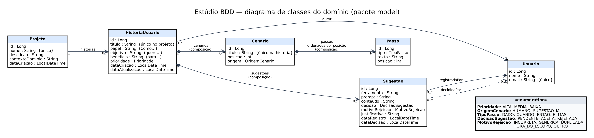

# Estúdio BDD

Aplicação para elaborar a documentação de requisitos de um sistema: o analista cadastra **histórias de usuário**
(Como… quero… para…) e seus **cenários** em Gherkin (Dado/Quando/Então), registra as **sugestões de IA** recebidas,
decide se **aceita ou rejeita** cada uma e, sem sugestões pendentes, **exporta a história como arquivo `.feature`**.

Projeto 2026/2 de Programação de Sistemas II. Entrega única: **17/11/2026** (versão marcada como `entrega-final`).

## Integrantes

| Nome | Matrícula | Responsabilidades principais |
|---|---|---|
| _(preencher)_ | | |
| _(preencher)_ | | |

## Tecnologias

- **API:** Java 17, Spring Boot 3.5, Spring Web, Spring Data JPA (Hibernate), Bean Validation, PostgreSQL 16.
- **Testes:** JUnit 5, Mockito, ArchUnit (rodam com `mvn test`, sem banco de dados).
- **SPA:** React 18 + Vite (JavaScript), sem bibliotecas de roteamento ou de estado.

## Como executar

Pré-requisitos: JDK 17+, Maven 3.9+, Node 18+ e Docker (ou um PostgreSQL local).

**1. Banco de dados (PostgreSQL)**

```bash
docker compose up -d          # cria o banco "estudio_bdd" (usuário e senha de desenvolvimento no docker-compose.yml)
```

Sem Docker: crie um banco `estudio_bdd` e um usuário no PostgreSQL local e informe-os por variáveis de ambiente
(`DB_URL`, `DB_USER`, `DB_PASSWORD`; veja `.env.example`). Os valores padrão de `application.yml` valem **apenas** para o
banco local do `docker-compose.yml`; nenhuma credencial real está no repositório.

**2. API** (porta 8080)

```bash
mvn spring-boot:run
```

Na primeira execução as tabelas são criadas (`ddl-auto: update`) e os **dados fictícios** são carregados
(`config/DadosFicticios`). Nas execuções seguintes os dados são mantidos; para recomeçar do zero:
`docker compose down -v`.

**3. SPA** (porta 5173)

```bash
cd frontend
npm install
npm run dev
```

Abra <http://localhost:5173>, escolha um usuário de demonstração e navegue. A SPA chama a API em
`http://localhost:8080/api` (mude com `VITE_API_URL`; veja `frontend/.env.example`). A API libera CORS **somente** para
`http://localhost:5173` (`app.cors.allowed-origins`).

**4. Testes e verificação**

```bash
mvn test                                  # 3 testes de regra + testes extras + ArchUnit
./scripts/roteiro-verificacao.sh          # roteiro da seção 13 contra a API no ar (curl)
```

## Dados fictícios (carregados na primeira execução)

| Usuário (id) | E-mail |
|---|---|
| Ana Souza (1) | ana@exemplo.com |
| Bruno Lima (2) | bruno@exemplo.com |
| Carla Dias (3) | carla@exemplo.com |

| Projeto | História (autor, prioridade) | Situação para demonstração |
|---|---|---|
| Loja Virtual | Login de cliente (Ana, ALTA) | 2 cenários (um com origem `SUGESTAO_IA`), sugestões decididas → **pode ser exportada** |
| Loja Virtual | Carrinho de compras (Bruno, MEDIA) | 1 cenário e **1 sugestão pendente** → exportação bloqueada |
| Loja Virtual | Busca de produtos (Ana, BAIXA) | **sem cenários** → exportação bloqueada |
| Biblioteca Escolar | Empréstimo de livro (Carla, ALTA) | 1 cenário, 1 sugestão rejeitada como `DUPLICADA` |

## Arquitetura: cinco camadas

```
SPA (React)  →  HTTP/JSON  →  controller  →  service  →  repository  →  PostgreSQL
 telas           DTOs         valida, converte  regras de     Spring Data      tabelas
 sem regras                   DTO ↔ domínio     negócio,      JPA
                                                transações
                                       model (entidades e enums) é usado por todas as camadas do back-end
```

| Pacote (`br.edu.estudiobdd`) | Papel |
|---|---|
| `controller` | Endpoints REST, `@Valid`, conversão DTO ↔ domínio, `TratadorDeErros` (ProblemDetail). **Não acessa repositórios.** |
| `dto` | Records de requisição/resposta com Bean Validation e métodos de conversão. |
| `service` | Regras de negócio e `@Transactional`: `ValidadorCenario` (regra 2), `RegrasAutoria` (regra 3), `SugestaoService` (regra 4), `ExportacaoService` + `GeradorGherkin` (regra 5), `ProjetoService` (regras 6 e 7). |
| `repository` | Interfaces Spring Data JPA (consultas derivadas e `@Query` de contagem). |
| `model` | Entidades JPA, enums e modelos de leitura (`HistoriaResumo`, `ResumoProjeto`). |
| `exception`, `config` | Exceções de negócio; CORS e carga de dados fictícios. |

**Caminho de "cadastrar um cenário"** (`POST /api/historias/{id}/cenarios`):

1. *SPA* — `CenarioEditor` monta `{titulo, origem, passos[]}` e `api.js` envia com o cabeçalho `X-Usuario-Id`.
2. *Controller* — `CenarioController.criar` valida o `CenarioRequest` (`@Valid`), converte para `Cenario` (`paraEntidade`) e chama o serviço.
3. *Serviço* — `CenarioService.criar` (`@Transactional`): identifica o usuário, carrega a história, exige que ele seja o autor
   (regra 3), valida a gramática com `ValidadorCenario` (regra 2), confere título único, numera os passos e associa o cenário à história.
4. *Repositório* — `CenarioRepository.save` persiste o cenário (e, em cascata, seus passos).
5. *Banco* — `INSERT` em `cenario` e `passo`; a resposta volta como `CenarioResponse` (201) ou como `ProblemDetail` (400/401/403/409/422).

## Diagrama de classes



Arquivos: `docs/diagrama-classes.png`, `docs/diagrama-classes.svg` e o fonte `docs/diagrama-classes.dot` (Graphviz).

## Endpoints

Documentação completa em [`docs/ENDPOINTS.md`](docs/ENDPOINTS.md) (métodos, cabeçalhos, corpos, códigos de resposta e exemplos).

## Decisões de projeto

- **Carregamento (LAZY/EAGER).** Todas as associações são `LAZY` (as `@ManyToOne` declaram isso explicitamente, pois o
  padrão do JPA seria EAGER). Assim, listar histórias não traz cenários, passos e sugestões junto. As contagens da consulta
  do projeto vêm de consultas agregadas (`group by`), e não de carregar coleções.
- **Open-in-view ligado (`spring.jpa.open-in-view: true`).** Como o enunciado manda o *controller* converter entidade em DTO,
  e as associações são LAZY, mantemos a sessão aberta durante a requisição para a conversão poder navegar nelas. É uma
  simplificação didática; alternativas seriam `JOIN FETCH`/`@EntityGraph` ou projeções, ao custo de mais consultas específicas.
- **Composição.** História → Cenários, História → Sugestões e Cenário → Passos usam `cascade = ALL` e `orphanRemoval = true`:
  excluir o pai remove os filhos. Passos ficam ordenados por `posicao` (`@OrderBy`) e são **renumerados** a cada alteração.
- **Códigos HTTP.** 422 para regra de negócio (ex.: cenário sem Então), 409 para duplicidade e para sugestão já decidida,
  403 para não-autor, 401 para identidade ausente.
- **A regra "rejeição exige motivo" mora no serviço**, não no DTO (`RejeitarSugestaoRequest.motivo` não tem `@NotNull`),
  conforme "serviço aplica as regras de negócio". Já campos obrigatórios (ex.: papel/objetivo/benefício) são validados por Bean Validation e
  também no serviço.
- **Unicidade em dois níveis:** verificação no serviço (mensagem clara, sem diferenciar maiúsculas/minúsculas) e *constraints*
  no banco (`uk_usuario_email`, `uk_projeto_nome`, `uk_historia_projeto_titulo`, `uk_cenario_historia_titulo`), com chaves estrangeiras
  nomeadas. Uma violação que escape do serviço vira 409.
- **Autoria (regra 3).** Só o autor edita/exclui a história, seus cenários e passos. Criar projetos, registrar e decidir
  sugestões não exige ser o autor (o enunciado só restringe história e cenários). *Ponto a confirmar com o professor.*
- **Excluir projeto** só é permitido se ele não tiver histórias (evita apagar o trabalho de outros autores).
- **Exportação.** Gera `# language: pt` + `Funcionalidade` (título) com Como/Quero/Para e um `Cenário` por cenário, na ordem
  das posições. Se o usuário já digitou "Como…/Quero…/Para…" nos campos, o prefixo não é duplicado.
- **Testes sem banco.** Regras são testadas no nível de serviço com Mockito; `mvn test` não precisa de PostgreSQL.

## Limitações conhecidas

- **Identidade simulada:** o cabeçalho `X-Usuario-Id` não é autenticação; qualquer cliente pode se passar por qualquer usuário.
  Em um sistema real, usar autenticação (por exemplo, Spring Security com tokens).
- O esquema do banco é gerenciado por `ddl-auto: update` (adequado ao trabalho; em produção, usar migrações como Flyway).
- Sem paginação nas listagens e sem integração com API de IA (as sugestões são registradas pelo usuário, como pede o enunciado).
- **Atividade bônus (fluxo configurável de aprovação): não implementada.**

## Registro de IA, verificação e estudo

- [`docs/REGISTRO_IA.md`](docs/REGISTRO_IA.md) — interações relevantes com IA (mínimo de 6: 3 da API e 3 da SPA).
- [`docs/bdd-a-mao.md`](docs/bdd-a-mao.md) — atividade inicial: história e 3 cenários escritos à mão e a primeira ampliação por IA.
- [`docs/ROTEIRO_VERIFICACAO.md`](docs/ROTEIRO_VERIFICACAO.md) — roteiro, resultados esperados e observados; evidências em `docs/evidencias/`.
- [`docs/exemplo-formato.feature`](docs/exemplo-formato.feature) — formato do arquivo exportado.
- [`AGENTS.md`](AGENTS.md) — regras de arquitetura e comandos para as ferramentas de IA.

## Checklist de entrega (Moodle, até 17/11/2026)

- [ ] Repositório com histórico de commits e a versão marcada `entrega-final` (`git tag entrega-final`); ZIP **sem** `target/`, `node_modules/` e credenciais.
- [ ] README com integrantes (este arquivo) e instruções para API, SPA e banco.
- [ ] Dados fictícios (já carregados por `DadosFicticios`) · diagrama de classes · documentação dos endpoints.
- [ ] Um `.feature` **exportado pelo sistema** em `docs/evidencias/` (o script de verificação salva um).
- [ ] Registro de IA (≥ 6 interações) · roteiro de verificação preenchido com resultados observados.
